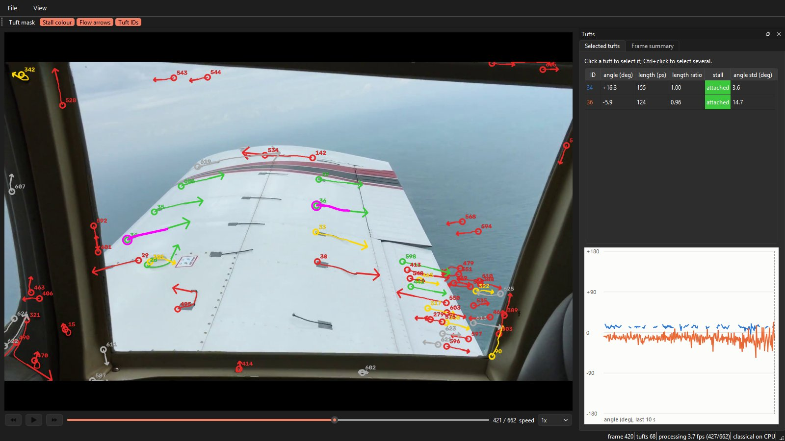

# Tuft Visual Detection System

Detects tufts (short strings taped to a surface) in video, measures each
tuft's flow direction (local tangent at the free tip), and will track tufts
and flag stalled flow. A U-Net with a pretrained resnet34 encoder replaces
the classical threshold step; everything downstream (skeleton, root/tip,
tip tangent, CSV) is shared by both backends.

SAM 2 is used **only** to build training labels, never for detection.

## Status

| Step | State |
|---|---|
| Review of the original U-Net work | `REVIEW.md` |
| Model, loss, augmentation, trainer (YAML) | done, tested; not yet trained on real data |
| Real-data pipeline: sources, frame selection, SAM 2 auto-label, review tool, model-in-the-loop | done, tested; waiting for footage |
| Synthetic generator (`synth_tufts.py`) | not started (off by default; ablation will decide if it is used) |
| `evaluate.py`, video input, tracker | not started |

No accuracy numbers exist yet. Every result will come from `evaluate.py`.

## Setup (Windows, RTX 5090)

```powershell
py -3.11 -m venv .venv-unet
.venv-unet\Scripts\python -m pip install --upgrade pip
.venv-unet\Scripts\python -m pip install -r Requirements-train.txt
# albumentations pulls in headless OpenCV, which breaks the review window:
.venv-unet\Scripts\python -m pip uninstall -y opencv-python opencv-python-headless
.venv-unet\Scripts\python -m pip install --no-deps opencv-python==5.0.0.93
# SAM 2 (labels only), pinned commit, without the optional CUDA extension:
.venv-unet\Scripts\python -m pip install setuptools wheel
$env:SAM2_BUILD_CUDA=0
.venv-unet\Scripts\python -m pip install --no-build-isolation "git+https://github.com/facebookresearch/sam2.git@2b90b9f5ceec907a1c18123530e92e794ad901a4"
mkdir models\sam2
curl.exe -L -o models\sam2\sam2.1_hiera_large.pt https://dl.fbaipublicfiles.com/segment_anything_2/092824/sam2.1_hiera_large.pt
# verify GPU, sm_120 kernels and OpenCV GUI before anything else:
.venv-unet\Scripts\python -m tools.check_env
```

`requirements-lock.txt` is the exact tested environment
(`pip install --no-deps -r requirements-lock.txt`).

Large data never goes into git: clips, frames, labels, runs and checkpoints
live under `data/`, `runs/` and `models/` (all ignored).

## Real-data pipeline

All commands run from the repo root with the venv's python
(`.venv-unet\Scripts\python`, shown as `python`).

### 1. Register clips (`sources.csv`)

Every clip goes into exactly one split. Keep part of the test set from our
own camera footage. `--use` is `tufts` (to label), `negative` (tuft-free
surface: hard negatives with empty masks) or `background` (for synthetic data).

```powershell
python -m tools.sources add-local D:\footage\run3.mp4 --split test --use tufts --notes "wind tunnel run 3"
python -m tools.sources add-local D:\footage\bare_wing.mp4 --split train --use negative
python -m tools.sources add-url "https://www.youtube.com/watch?v=XXXX" --split train --use tufts
python -m tools.sources check
python -m tools.sources list
```

`add-url` reads the YouTube metadata first and refuses anything that is not
Creative Commons unless you add `--permission "who granted it, when"`.
Clips below 720p are refused; heavily compressed ones are refused unless `--force`.

### 2. Pick diverse frames

```powershell
python -m tools.extract_frames --total 500                    # tuft clips, spread evenly across clips
python -m tools.extract_frames --use negative --total 80      # hard-negative frames
```

Frames are chosen by farthest-point sampling over scene thumbnail, lighting
and motion energy (a proxy for fluttering / stalled tufts), with near-duplicate
removal and a minimum time gap. Target: 300-500 reviewed frames from 10+ clips.

### 3. Auto-label with SAM 2

Per-clip detector settings (polarity, tape anchoring, ROI, size limits) go in
`configs/autolabel.yaml`.

```powershell
python -m tools.auto_label                       # all extracted frames not yet labelled
python -m tools.auto_label --clips own_run3 --limit 20
```

Output: `data/real/proposed/` (images, labels, `json/<stem>.json` with
root/tip/angle per tuft, `meta.json`). Negative clips become empty-mask proposals.

### 4. Review

```powershell
python -m tools.review_labels --data data/real/proposed --out data/real/labeled
```

| Key / mouse | Action |
|---|---|
| `a` / `r` | accept / reject frame (accepted frames become training data) |
| left click | delete the tuft under the cursor, or restore a red (SAM-rejected) candidate |
| `b` / `e`, drag | brush add / erase; `v` back to click mode; `[` `]` brush size |
| wheel / right-drag | zoom at cursor / pan |
| `z`, `n` / `p`, `m`, `q` | undo, next / prev, toggle overlay, quit |

Every decision and edit is logged to `data/real/review_log.jsonl` with time spent.

#### Faster: one tuft at a time

Frames with hundreds of tufts are quicker to judge one candidate at a time:

```powershell
python -m tools.vote_tufts                  # cards from train + val clips, shuffled; y / n / u, s skip, z undo, q quit
python -m tools.build_from_votes            # -> data/real/voted (+ data/real/voted_sheet.jpg)
python -m tools.train --config configs/unet_resnet34.yaml --set "data.real=[data/real/voted]"
```

Faster still, a grid of look-alike cards at a time (`python -m tools.vote_groups`):
click the odd ones to give them their own vote, then `y` / `n` / `u` votes the rest.
Same `votes.jsonl`, so both tools mix.

`y` = tuft, `n` = background (hard negative), `u` / unvoted = ignore (no loss), so an
unjudged tuft is never taught as background. Votes go to `data/real/votes.jsonl`;
restarting continues where you stopped.

### 5. Train

```powershell
python -m tools.train --config configs/unet_resnet34.yaml
python -m tools.train --config configs/unet_resnet34.yaml --set train.epochs=80 loss.w_cldice=0.3
```

Real frames only by default (`data.synthetic_share: 0`). Splits come from
`sources.csv` by clip; the test split is never loaded. Each run writes
`runs/<name>_<time>/` with the resolved config, split manifest, CSV and
TensorBoard logs, sample sheets (image | ground truth | prediction) and
`checkpoints/best.pt` + `last.pt` (`--resume` continues a run).

### 6. Model-in-the-loop rounds

```powershell
python -m tools.loop_round --clips yt_new1 own_run7 --weights runs/LATEST
```

Extracts frames from the new clips, runs the current U-Net on them, opens the
review tool on exactly those frames, then retrains on all accepted frames
(warm start; `--fresh` to retrain from ImageNet, `--no-train` to stop after review).

### External data: DLR in-flight tufts (Zenodo 10539950)

Lee, Olsman & Triebel, "Learning Fluid Flow Visualizations From In-Flight Images
With Tufts", IEEE RA-L 2023, doi 10.1109/LRA.2023.3270746. Zenodo lists CC BY 4.0
and also MIT in its Rights section; cite the paper either way.

```powershell
# unzip tufts.zip into data/external/dlr_tufts/ first, then:
python -m tools.view_dlr                                  # annotation contact sheet
python -m tools.import_dlr polygons                       # 50 HABLEG polygon frames -> data/dlr/hableg_polygons
python -m tools.import_dlr boxes                          # SAM 2 masks from HABLEG boxes -> data/dlr/hableg_sam2/proposed
python -m tools.import_dlr tracks                         # tracker ground truth -> data/dlr/hableg_tracks
python -m tools.import_dlr sheet --data data/dlr/hableg_sam2/proposed --stems-file data/dlr/hableg_sam2/proposed/review_batch1.txt --out data/dlr/preview_sam2.jpg --open
python -m tools.review_labels --data data/dlr/hableg_sam2/proposed --out data/dlr/hableg_sam2/labeled --stems-file data/dlr/hableg_sam2/proposed/review_batch1.txt
```

HABLEG sessions GOPR, GP02, GP04 are train; GP03 is external validation (human
polygons only).

EC135 (helicopter tail): tufts on the inner duct ring are often unboxed, so the
ring band 0.8-1.0 x the fitted duct ellipse gets zero loss (boxed / outlined
tufts in it stay labelled). Frames without a trustworthy duct fit are dropped
(`src/duct_fit.py`: 392 of 982 frames pass). Split by DSC number: val blocks
2741-2789, 3061-3109, 3361-3409, 20-number gaps dropped.

```powershell
python -m tools.import_ec135 fit          # duct fit + sanity check per frame -> data/dlr/ec135_fits.json
python -m tools.import_ec135 sheet        # contact sheets of accepted fits with the band
python -m tools.import_ec135 polygons     # human outlines (fit must pass) -> data/dlr/ec135_polygons
python -m tools.import_ec135 boxes        # SAM 2 from boxes -> data/dlr/ec135_sam2/proposed
python -m tools.import_dlr clean --data data/dlr/ec135_sam2/proposed
python -m tools.import_ec135 detag        # tape tags SAM included -> ignore
python -m tools.import_dlr promote --src data/dlr/ec135_sam2/proposed --out data/dlr/ec135_sam2/labeled
python -m tools.eval_dlr --weights A=runs/<run>/checkpoints/best.pt   # GP03 + EC135 val, DLR validation only
```

DLR frames get extra colour augmentation (hue, grayscale, inversion) because
their tufts are red/dark and ours are white. Validation is reported per domain:
`val_dlr_*` numbers are DLR validation only, never our accuracy.

Pipeline test on DLR data only (after the review batch is accepted):

```powershell
python -m tools.train --config configs/unet_resnet34.yaml --set "data.real=[data/dlr/hableg_polygons,data/dlr/hableg_sam2/labeled]" run.name=dlr_pipeline_test
```

### Detection on an image (classical or U-Net)

```powershell
python main.py --image frame.png --polarity light --tape-root --roi 600,650,1650,650
python main.py --image frame.png --backend unet --weights runs\<run>\checkpoints\best.pt
```

Detection always runs at native resolution; set `--min/max-length-px` and
`--min/max-area` to match how large tufts are in your footage.

## TuftView desktop app

```powershell
python -m app                         # or: python -m app path	oideo.mp4
```

Open a video (File > Open, or drag it onto the window; MP4 / MOV / AVI, 720p-1440p).
Processing runs in a background thread: detector (U-Net or classical) -> geometry
(root, tip, tip tangent) -> tracker (persistent IDs, stall state). Results are cached
per frame, so scrubbing back never reprocesses; playback waits at the processing front.



*Classical backend on a YouTube stall clip. Arrows show the flow direction at each tip,
coloured by stall state (green attached, yellow unsteady, red separated, grey not yet
known). Tufts 34 and 36 are selected (magenta); the side panel shows their angle,
length, length ratio, stall state and angle over the last 10 s. The red marks around the
window frame and over the sea are false detections of the classical threshold.*

| Control | Action |
|---|---|
| Space, Left / Right | play / pause, step one frame |
| Scrub bar, speed box | jump to a frame, 0.25x - 4x playback |
| Click / Ctrl+click a tuft | select it / add or remove it (view only, no editing) |
| View menu or toolbar | toggle mask, flow arrows, IDs, stall colour |
| File > Export (Ctrl+E) | annotated MP4, per-frame CSV of all tufts, CSV of selected tufts |
| File > Settings (Ctrl+,) | backend, checkpoint, confidence threshold, length limits, overlays (saved) |

The status bar shows processing fps, frame number, tuft count and CPU/GPU.

Architecture (for adding features):
- `core/` has no Qt: `Pipeline.process_frame(frame) -> FrameResult` (tufts with track
  IDs and stall labels, mask), `Tracker` (with a `PointPredictor` interface for a
  learned point tracker later), `FrameSource` (`VideoFileSource`; `CameraSource` is a
  placeholder), CSV export.
- `app/overlays/`: register a new overlay with `@register_overlay` (it draws with
  OpenCV, so it appears in exports too).
- `app/panels/`: register a new side panel with `@register_panel` (gets frame and
  selection updates).
- Resources load through `app.resource_path()`, which also works in a PyInstaller bundle.

## Tests

```powershell
python -m pytest -q tests
```
